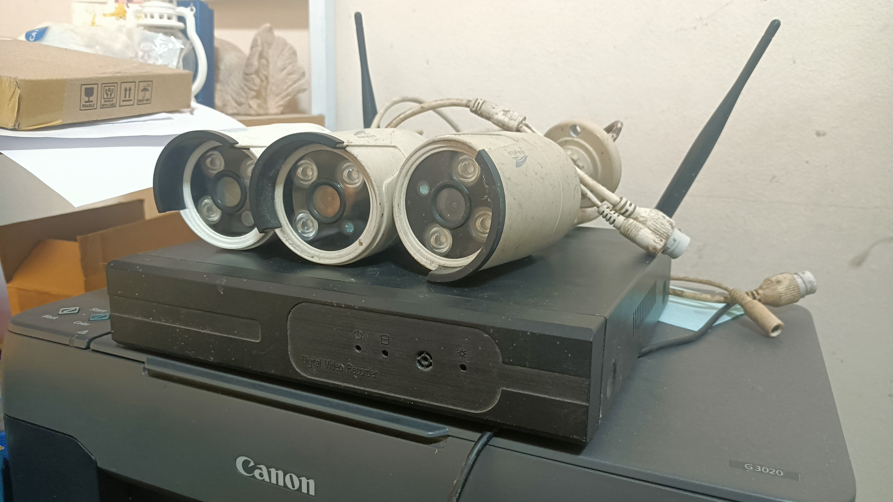
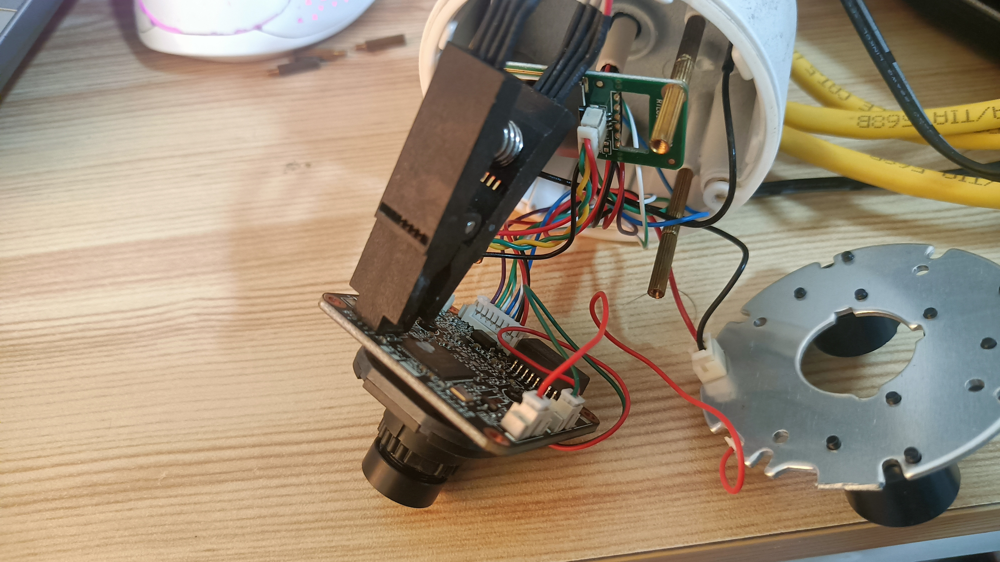
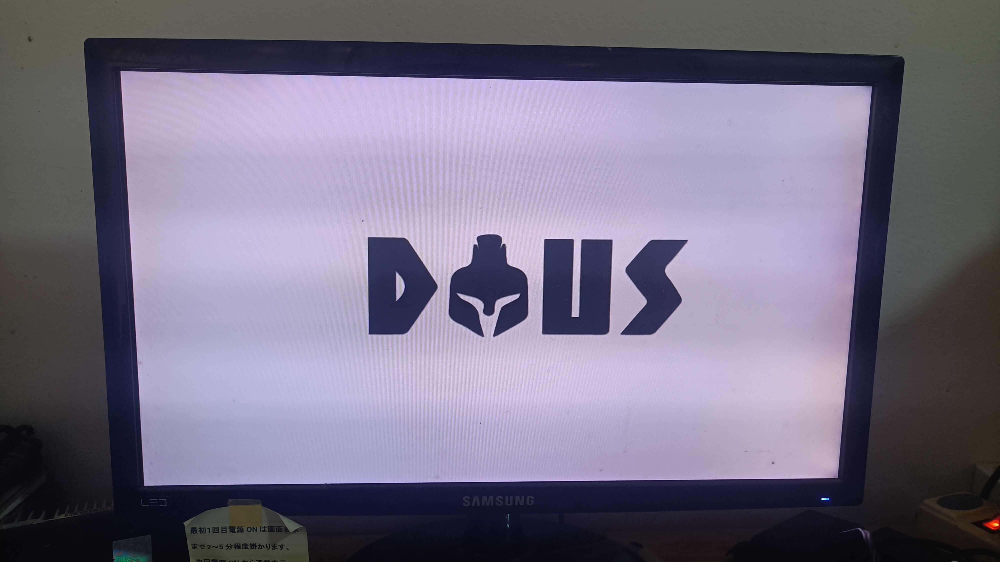
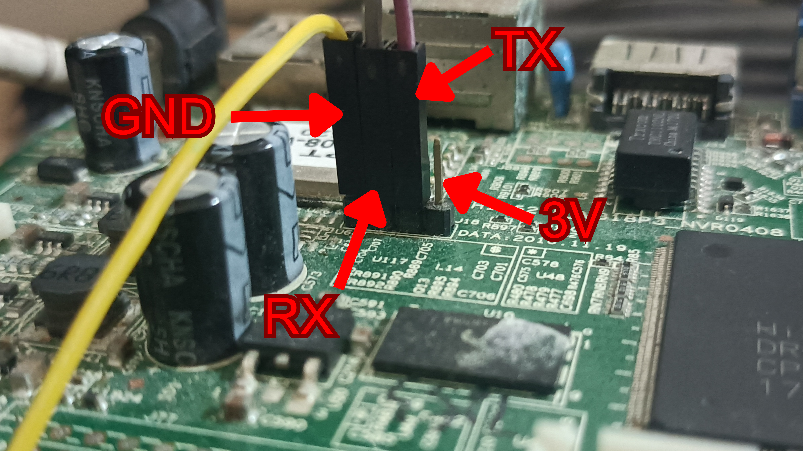

# Anyka/Juanvision IP Camera Anyka AK3918EN080 and K9608-W NVR — Firmware Analysis Summary

This document consolidates the key findings from the IPC RTSP analysis and the K9608-W NVR firmware analysis. It is intended as a concise repository overview; detailed reverse-engineering notes and command logs can remain in the original reports.



## Overview

- **Camera:** Anyka/Juanvision/JIUAN-family IPC firmware image `ipc1824.bin`.
- **Camera SoC/processor:** Anyka `AK3918EN080` (hardware identification supplied for this device; verify against chip markings or board documentation if publishing).
- **NVR:** K9608-W, an 8-channel NVR based on HiSilicon Hi3520D and Linux 3.0.8.
- **Main finding:** The analyzed camera firmware includes an RTSP server on TCP port `554`, gated by `[cloud] n1 = 1`, not by `rtsp_support`.
- **NVR integration:** The NVR communicates with the camera using the vendor N1/HiChip NetSDK over HTTP port `80`. It is not confirmed to provide an RTSP bridge.

## Camera Hardware

- **SoC / processor:** Anyka `AK3918EN080`.
- **Firmware image analyzed:** `ipc1824.bin`.
- **Main application:** `/usr/bin/anyka_ipc`.


The SoC identification describes the camera hardware; the RTSP findings below are specific to the analyzed firmware image and may differ across firmware versions.

## Key Findings

### 1. Camera RTSP

For the analyzed `ipc1824.bin` image:

- The main application is `/usr/bin/anyka_ipc`; the embedded MiniRTSP implementation reports version `1.0.3.5` and banner `minirtsp 2.2`.
- RTSP starts during `n1_init()`, which is called when `[cloud] n1 = 1` in `/etc/jffs2/anyka_cfg.ini`.
- The `rtsp_support` configuration value is parsed and saved, but the analyzed binary does not use it to control RTSP.
- RTSP listens on port `554`, bound to all interfaces. The port appears hardcoded in this build.
- The same initialization path starts the web UI on port `80` and initializes ONVIF services.
- Stream paths found in the binary:
  - `/ch0_0.264` — main stream
  - `/ch0_1.264` — sub-stream
  - `/ch1/main/av_stream` — ONVIF main stream
  - `/ch1/sub/av_stream` — ONVIF sub-stream
- The SDP template advertises H.264 video and PCMA audio.

### 2. Camera Authentication

- The analyzed image has no `/etc/jffs2/usr.conf` user database.
- In that condition, `n1_init` creates the default `admin` user with an empty password.
- The RTSP authentication code also contains a special case that accepts `admin` with an empty password.
- The RTSP user database is separate from the web login in this build; changing the web password may not change RTSP credentials.

**Security warning:** Empty/default credentials and unauthenticated management exposure are significant risks. Use these observations only on devices you own or are authorized to test. Change credentials where possible and isolate legacy cameras from untrusted networks.

### 3. NVR Architecture

- The K9608-W NVR uses a HiSilicon Hi3520D SoC, Linux 3.0.8, and a 16 MiB SPI NOR flash.
- Its main application is `/root/dvr_app/dvr_app`; the app filesystem is mounted read-only from a SquashFS image.
- The NVR's camera-ingest path uses N1/HiChip NetSDK over HTTP port `80`, including `/cgi-bin/gw2.cgi` and `/NetSDK/...` endpoints.
- The captured boot log shows no MiniRTSP listener startup and no observed listener on port `554`.
- The NVR's own live output is exposed through HTTP (`/bubble/live`), RTMP, and JAP2P services in the captured run. RTSP strings exist in the binary, but an NVR-side RTSP server remains unconfirmed.


This is UART pinout on Hi3520D board


### 4. Cross-Check Between Camera and NVR

- The NVR's vendor configuration lists JIUAN camera defaults as `admin` with an empty password, consistent with the analyzed camera image.
- A stored camera record reports firmware `2.2.15.391806(2.4.0.20)`, whereas the analyzed camera image is `2.2.15_W` (build dated 2017-08-07).
- This firmware mismatch matters: exact RTSP behavior, code offsets, and stream paths should be revalidated against the firmware actually running on the device.
- The NVR is not an RTSP bridge. Adding a camera to the NVR provides NVR viewing functionality, but does not establish a new RTSP URL for that camera.

## Verification Checklist

Run these checks on a device you own or are authorized to test. Replace the example IP address with the camera's address.

```sh
# Check the camera's RTSP port from a PC on the same LAN
nmap -Pn -p 80,554 192.168.1.88

# Probe the RTSP service; a 401 challenge can indicate a responding server
printf 'OPTIONS * RTSP/1.0\r\nCSeq: 1\r\n\r\n' | nc -w 3 192.168.1.88 554

# Check a stream with FFmpeg tools, forcing RTSP-over-TCP
ffprobe -v verbose -rtsp_transport tcp \
  'rtsp://admin:@192.168.1.88:554/ch0_0.264'

ffplay -rtsp_transport tcp \
  'rtsp://admin:@192.168.1.88:554/ch0_0.264'
```

Interpretation:

- `401 Unauthorized` plus a `WWW-Authenticate: Digest` header and MiniRTSP server banner indicates that the RTSP service is responding; it does not by itself prove that playback will succeed.
- `404` or `454` may indicate an unsupported stream path.
- Connection refused or timeout suggests the service is not reachable; check the running firmware, network path, and `[cloud] n1` setting.
- A connection that succeeds but produces no video may be a transport, audio, codec, or hardware issue. Try RTSP-over-TCP and, if needed, the sub-stream path.

## Configuration Notes

For the analyzed camera image only:

- Runtime configuration: `/etc/jffs2/anyka_cfg.ini`
- Factory defaults: `/usr/local/factory_cfg.ini`
- RTSP-related startup gate: `[cloud] n1 = 1`
- `rtsp_support` is not the operative gate in this build.
- Setting `n1 = 0` skips `n1_init`, which also affects N1-related services such as the web UI and ONVIF in this firmware.

Do not flash modified firmware without a verified recovery method. Firmware headers may contain checksums or signatures, and a firmware mismatch can make binary offsets or configuration assumptions invalid.

## Limitations and Open Questions

1. Confirm the camera's exact firmware version and hardware identity before relying on image-specific conclusions.
2. Verify RTSP `SETUP` and `PLAY` on real hardware; emulation can validate signaling but cannot reproduce ISP/codec output.
3. Recheck RTSP paths and configuration behavior if the device runs `2.2.15.391806(2.4.0.20)` or another build rather than the analyzed `2.2.15_W` image.
4. NVR-side RTSP output is not confirmed by the captured boot log.
5. The NVR's stored camera record and network addresses are device-specific; redact identifiers before publishing logs.
